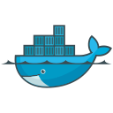

  Programming Languages · Hover an icon to see its name  
  
  
  
  
  
  
  
    
  Frameworks and Tools · Hover an icon to see its name  
  
  
  
  
  
  
  
  
   
  
  
  
  
  
  
  
  
  
  
    
  Databases · Hover an icon to see its name  
  
  
  
  
  

  

