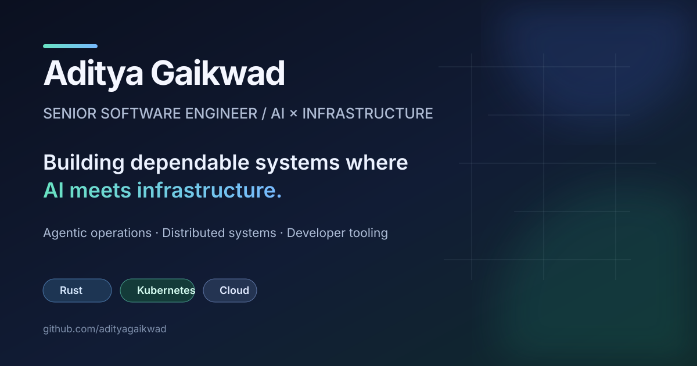

  

### Building dependable systems where AI meets infrastructure

Senior Software Engineer at Meta. I work on AI-assisted operations, infrastructure automation, and data tooling that makes complex systems easier to understand and operate.

**What I work with:** Rust · Python · TypeScript · Kubernetes · AWS · GCP · Kafka · PostgreSQL

**How I work:** I use agentic workflows, structured data, deterministic tooling, and evaluation harnesses to make AI-assisted engineering more useful and reproducible.

Background

- Building AI-agent and automation workflows for large-scale storage-platform operations.
- Previously built cloud control-plane, Kubernetes, log-ingestion, and distributed search systems at VMware/Broadcom.
- M.S. in Computer Science, Stony Brook University.

### Selected repositories

I keep my public projects curated. The pinned repositories below are the best place to see work, experiments, and developer tooling I choose to share.

  <a href="https://www.linkedin.com/in/aditya-gaikwad">LinkedIn</a>
  ·
  <a href="mailto:adityaravindragaikwad@gmail.com">Email</a>

